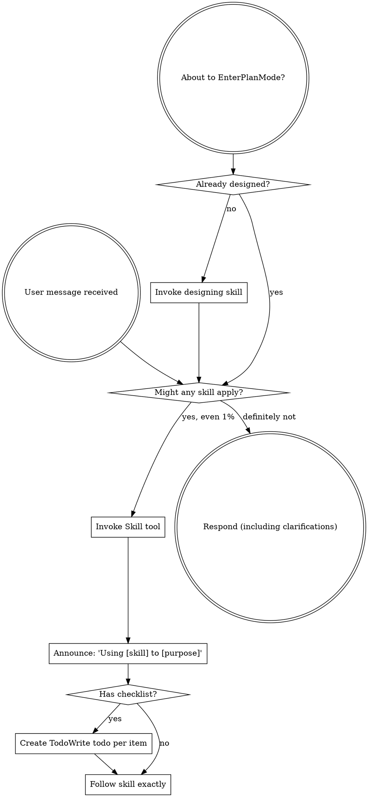

<SUBAGENT-STOP>
If you were dispatched as a subagent to execute a specific task, skip this skill.
</SUBAGENT-STOP>

<EXTREMELY-IMPORTANT>
If you think there is even a 1% chance a skill might apply to what you are doing, you ABSOLUTELY MUST invoke the skill.

IF A SKILL APPLIES TO YOUR TASK, YOU DO NOT HAVE A CHOICE. YOU MUST USE IT.

This is not negotiable. This is not optional. You cannot rationalize your way out of this.
</EXTREMELY-IMPORTANT>

## Instruction Priority

Tentacles skills override default system prompt behavior, but **user instructions always take precedence**:

1. **User's explicit instructions** (CLAUDE.md, direct requests) — highest priority
2. **Tentacles skills** — override default system behavior where they conflict
3. **Default system prompt** — lowest priority

If CLAUDE.md says "don't use the parallel dispatcher" and a skill says "always dispatch in parallel," follow the user's instructions. The user is in control.

## How to Access Skills

Use the `Skill` tool. When you invoke a skill, its content is loaded and presented to you — follow it directly. Never use the Read tool on skill files.

# Using Skills

## The Rule

**Invoke relevant or requested skills BEFORE any response or action.** Even a 1% chance a skill might apply means that you should invoke the skill to check. If an invoked skill turns out to be wrong for the situation, you don't need to use it.

## The Main Flow

Tentacles is built around one workflow: **design → plan → parallel execution**.

1. **`tentacles:designing`** — Socratic refinement of intent and requirements before any code or plan.
2. **`tentacles:writing-plans`** — Turn the design into a dependency-oriented Execution Graph.
3. **`tentacles:parallel-subagent-execution`** — Dispatch worktree-isolated implementer subagents per parallel group, merge as groups complete.

Supporting skills: `tentacles:using-git-worktrees`, `tentacles:verification-before-completion`, `tentacles:tests-required`, `tentacles:requesting-code-review`, `tentacles:receiving-code-review`, `tentacles:finishing-a-development-branch`, `tentacles:dispatching-parallel-agents`.

## Red Flags

These thoughts mean STOP — you're rationalizing:

| Thought | Reality |
|---------|---------|
| "This is just a simple question" | Questions are tasks. Check for skills. |
| "I need more context first" | Skill check comes BEFORE clarifying questions. |
| "Let me explore the codebase first" | Skills tell you HOW to explore. Check first. |
| "I can check git/files quickly" | Files lack conversation context. Check for skills. |
| "Let me gather information first" | Skills tell you HOW to gather information. |
| "This doesn't need a formal skill" | If a skill exists, use it. |
| "I remember this skill" | Skills evolve. Read current version. |
| "This doesn't count as a task" | Action = task. Check for skills. |
| "The skill is overkill" | Simple things become complex. Use it. |
| "I'll just do this one thing first" | Check BEFORE doing anything. |
| "This feels productive" | Undisciplined action wastes time. Skills prevent this. |
| "I know what that means" | Knowing the concept ≠ using the skill. Invoke it. |

## Skill Priority

When multiple skills could apply, use this order:

1. **Process skills first** (designing, writing-plans) — these determine HOW to approach the task
2. **Execution skills second** (parallel-subagent-execution, dispatching-parallel-agents) — these guide dispatch
3. **Checkpoint skills last** (verification-before-completion, requesting-code-review, finishing-a-development-branch)

"Let's build X" → designing first, then writing-plans, then parallel execution.

## Skill Types

**Rigid** (verification-before-completion, tests-required): Follow exactly. Don't adapt away discipline.

**Flexible** (designing, patterns): Adapt principles to context.

The skill itself tells you which.

## User Instructions

Instructions say WHAT, not HOW. "Add X" or "Fix Y" doesn't mean skip workflows.
